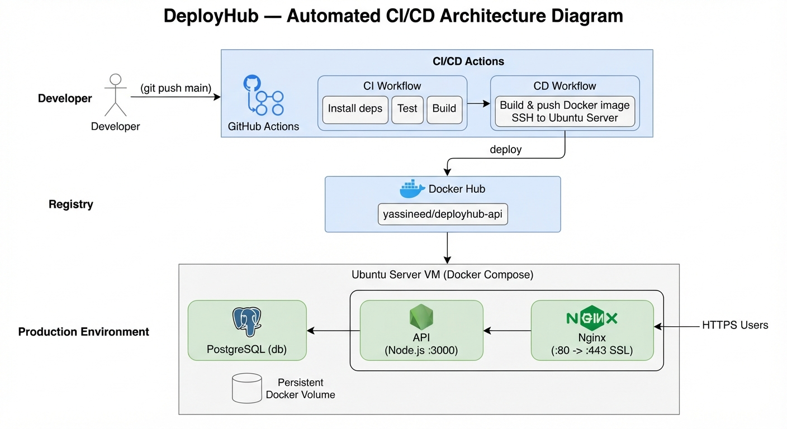

🚀 DeployHub — Automated CI/CD Deployment Platform

DeployHub is an end-to-end DevOps and deployment automation project built with Docker, Docker Compose, Nginx (HTTPS Reverse Proxy), PostgreSQL, GitHub Actions (CI/CD), and Bash on an Ubuntu Server.

🧭 Architecture & CI/CD Flow

Developer
   │
   │ git push (main)
   ▼
GitHub Actions
   ├── CI: Install dependencies, run tests, build
   └── CD: Build & push Docker image → SSH to Ubuntu Server
          │
          ▼
   Docker Hub (yassineed/deployhub-api)
          │
          ▼
   Ubuntu Server VM (Docker Compose)
       ┌────┴────────────────┐
       ▼                     ▼
  PostgreSQL (db)      API (Node.js :3000)
                             ▲
                             │
                       Nginx (:80 → :443 SSL)

🛠️ Tech Stack

Application: Node.js REST API (GET /health and /tasks CRUD) + pg client

Database: PostgreSQL 16 (postgres:16-alpine) with persistent Docker volume

Reverse Proxy & TLS: Nginx (nginx:alpine) redirecting :80 to :443 (SSL/TLS) and forwarding traffic to api:3000

Containerization: Docker & Docker Compose

CI/CD: GitHub Actions (automated tests, image build/push, SSH deployment)

Automation & Ops: Bash scripts (deploy.sh, health-check.sh, backup.sh, rollback.sh, cleanup.sh) on Ubuntu Server

📂 Project Structure

deployhub/
├── app/                  # REST API source code and tests
├── docker/               # Dockerfile and container build config
├── nginx/                # Nginx HTTP/HTTPS reverse proxy configuration
├── scripts/              # Operational Bash scripts
│   ├── deploy.sh         # Zero-downtime-style rollout & health verification
│   ├── health-check.sh   # API, DB, Docker, Nginx & host metrics check
│   ├── backup.sh         # PostgreSQL backup creation & integrity check
│   ├── rollback.sh       # Versioned/tagged image rollback & verification
│   └── cleanup.sh        # Safe pruning of dangling images, old cache & backups
├── .github/workflows/    # GitHub Actions CI & CD workflows
├── docker-compose.yml    # Multi-service stack definition
└── .env.example          # Environment variable template

⚙️ Environment Variables

Copy .env.example to .env and configure your credentials:

cp .env.example .env

Key variables include:

POSTGRES_USER, POSTGRES_PASSWORD, POSTGRES_DB

DB_HOST, DB_PORT, DB_USER, DB_PASSWORD, DB_NAME

API_IMAGE_TAG (defaults to latest, used during rollbacks)

🚀 Deployment & Operations

Start / Manage Stack

docker compose up -d
docker compose ps
docker compose logs -f

Deploy New Version (scripts/deploy.sh)

Tags the current image as :previous, pulls the latest image, updates services without a full stack down, waits for https://localhost/health, and runs health-check.sh:

./scripts/deploy.sh

Health Check (scripts/health-check.sh)

Checks https://localhost/health, PostgreSQL readiness (pg_isready), Docker daemon, Nginx status, CPU, memory, and disk usage:

./scripts/health-check.sh

Database Backup (scripts/backup.sh)

Creates timestamped PostgreSQL dumps inside backups/ and verifies dump validity:

./scripts/backup.sh

Rollback (scripts/rollback.sh)

Rolls the api service back to a specified image tag (such as previous or a release tag), verifies /health, and runs a post-rollback health check:

./scripts/rollback.sh previous

Safe Cleanup (scripts/cleanup.sh)

Removes dangling (<untagged>) images, build cache older than 7 days, and backup files older than 7 days—while preserving tagged images and active backups (supports --dry-run):

./scripts/cleanup.sh --dry-run
./scripts/cleanup.sh

💡 Lessons Learned

Avoid full-stack downtime and destructive pruning: Replacing docker compose down with docker compose up -d --remove-orphans and replacing docker system prune -f with targeted pruning (docker image prune -f + docker builder prune --filter "until=168h" -f) prevents accidental loss of rollback images and unnecessary service interruptions.

Verify the real HTTPS path: Because Nginx redirects HTTP (:80) to HTTPS (:443), health checks should target https://localhost/health rather than relying on a single sleep or raw HTTP redirect check.

Keep environment and build paths consistent: Aligning app/db.js environment variables (DB_*) and Dockerfile copy paths (./app build context) with docker-compose.yml prevents runtime connection and build-context mismatches.
