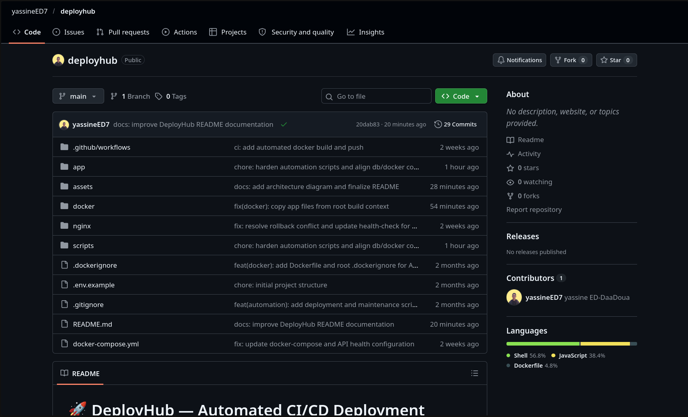
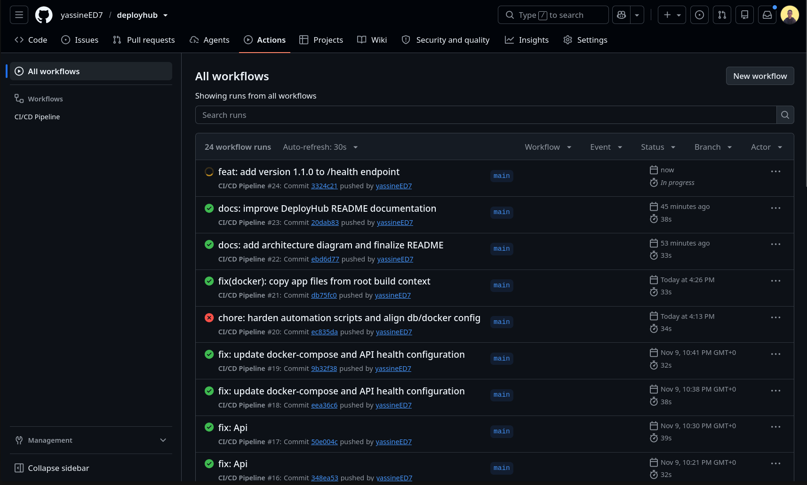
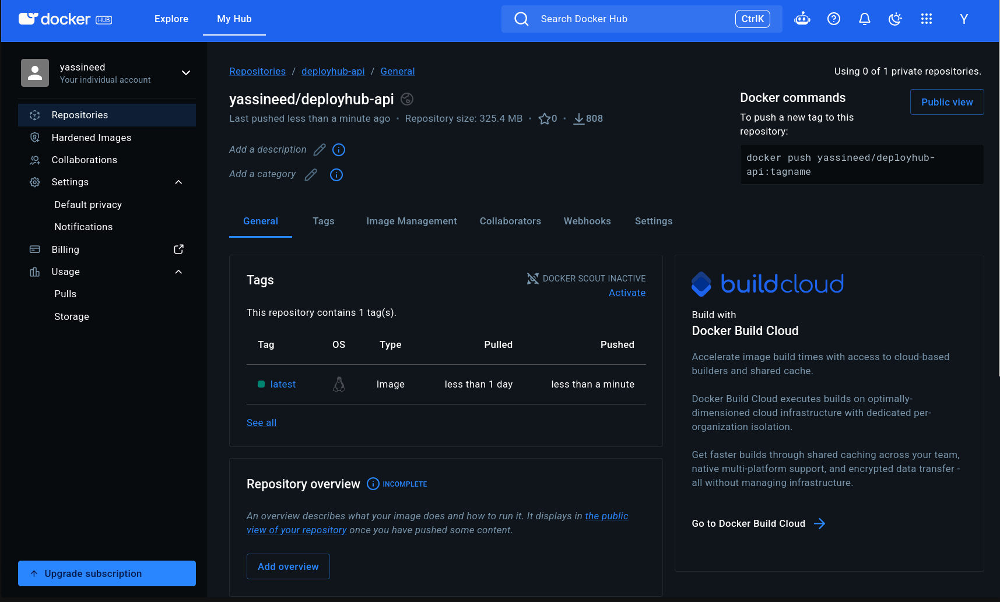
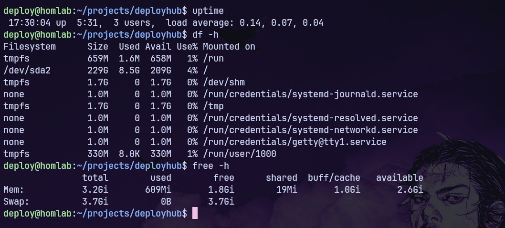
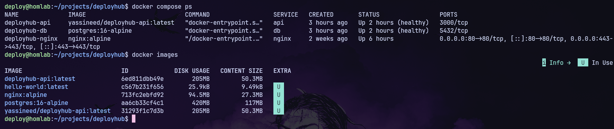
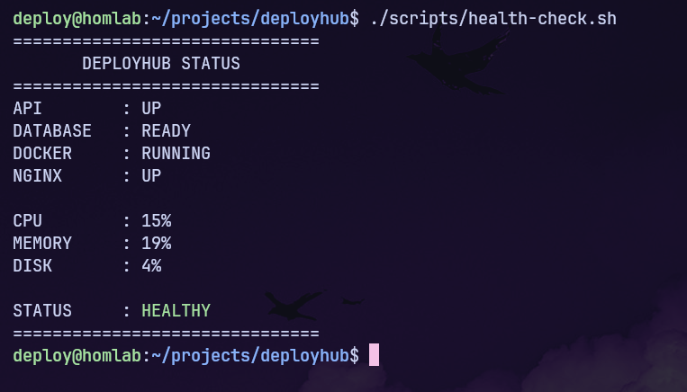
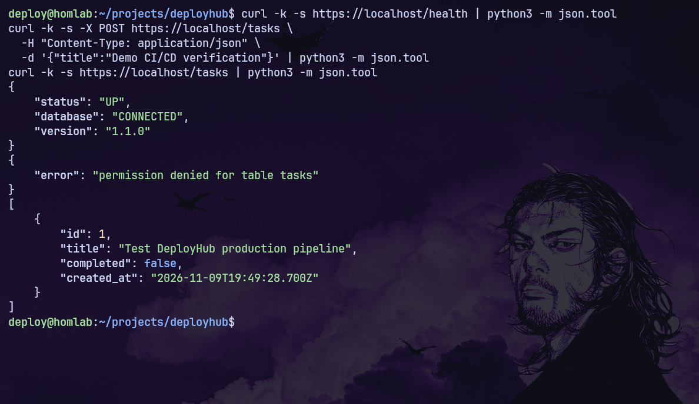
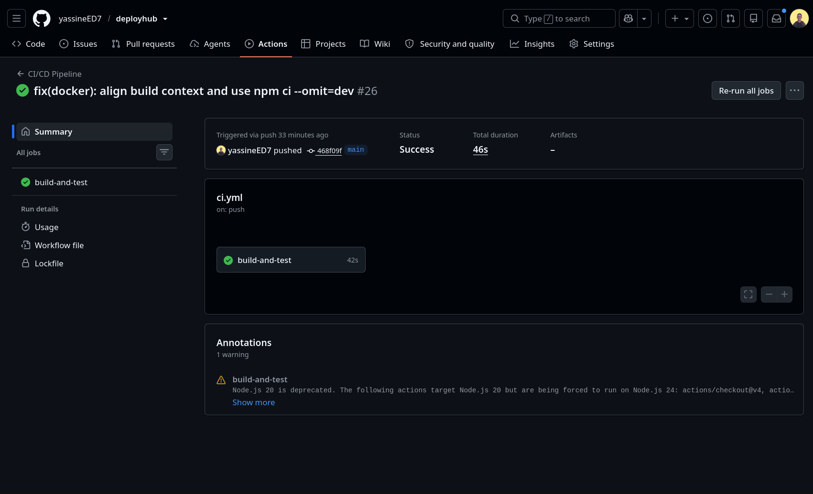
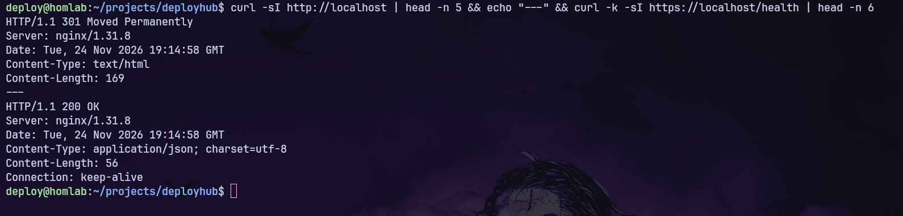

# 🚀 DeployHub — Automated CI/CD Deployment Platform

DeployHub is an end-to-end DevOps project designed to automate application deployment and server operations using modern containerization and CI/CD practices.

The platform integrates **Docker, Docker Compose, Nginx, PostgreSQL, GitHub Actions, and Bash** to provide an automated deployment workflow on an Ubuntu Server.

## 🧭 Architecture & CI/CD Workflow


```text
Developer
   │
   │ git push (main)
   ▼
GitHub Actions
   ├── CI: Install dependencies, run tests, and build
   └── CD: Build & push Docker image → SSH deployment
          │
          ▼
Docker Hub
(yassineed/deployhub-api)
          │
          ▼
Ubuntu Server VM
(Docker Compose)
   │
   ├── PostgreSQL (db)
   │
   └── API (Node.js :3000)
          ▲
          │
       Nginx
   (:80 → :443 SSL)
```

### Deployment Workflow

1. A developer pushes new code to the `main` branch.
2. GitHub Actions triggers the CI/CD pipeline.
3. The CI stage installs dependencies, runs tests, and validates the application build.
4. The CD stage builds and pushes a Docker image to Docker Hub.
5. GitHub Actions connects to the Ubuntu Server through SSH.
6. The deployment process pulls the new image and updates the running application.
7. Nginx handles HTTPS traffic and forwards requests to the API.
8. Health checks verify that the application and its services are running correctly.

## 🛠️ Tech Stack

| Component | Technology | Purpose |
|---|---|---|
| Application | Node.js | REST API and application logic |
| API | REST + pg | Health endpoint and Tasks CRUD |
| Database | PostgreSQL 16 | Persistent relational data storage |
| Reverse Proxy | Nginx | HTTP/HTTPS traffic management |
| SSL/TLS | HTTPS | Secure communication |
| Containerization | Docker | Application containerization |
| Orchestration | Docker Compose | Multi-container management |
| CI/CD | GitHub Actions | Automated testing and deployment |
| Image Registry | Docker Hub | Docker image storage |
| Server | Ubuntu Server | Deployment environment |
| Automation | Bash | Deployment and maintenance scripts |

## ✨ Key Features

- **Automated CI/CD:** Build, test, publish, and deploy application updates through GitHub Actions.
- **Containerized Architecture:** Isolated API and PostgreSQL services managed with Docker Compose.
- **HTTPS Reverse Proxy:** Nginx redirects HTTP traffic to HTTPS and forwards requests to the API.
- **Persistent Database:** PostgreSQL data is stored using Docker volumes.
- **Deployment Automation:** Bash scripts simplify application updates and operational tasks.
- **Health Monitoring:** Checks application availability, database readiness, Docker, Nginx, and server resources.
- **Database Backups:** Creates timestamped PostgreSQL backups and verifies their integrity.
- **Rollback Support:** Restores previous application versions using tagged Docker images.
- **Safe Cleanup:** Removes unnecessary Docker resources and expired backups while preserving important images.

## 📂 Project Structure

```text
deployhub/
│
├── app/                      # REST API source code and tests
│
├── docker/                   # Dockerfile and build configuration
│
├── nginx/                    # Nginx reverse proxy and SSL configuration
│
├── scripts/
│   ├── deploy.sh             # Automated deployment and health verification
│   ├── health-check.sh       # Application, database and server checks
│   ├── backup.sh             # PostgreSQL backup and integrity verification
│   ├── rollback.sh           # Previous version restoration
│   └── cleanup.sh            # Safe Docker and backup cleanup
│
├── .github/
│   └── workflows/            # GitHub Actions CI/CD workflows
│
├── docker-compose.yml        # Multi-service configuration
│
└── .env.example              # Environment variable template
```

## ⚙️ Environment Configuration

Create your environment configuration file from the provided template:

```bash
cp .env.example .env
```

Configure the required environment variables:

```env
POSTGRES_USER=
POSTGRES_PASSWORD=
POSTGRES_DB=

DB_HOST=
DB_PORT=
DB_USER=
DB_PASSWORD=
DB_NAME=

API_IMAGE_TAG=latest
```

**Important:** Keep sensitive credentials in `.env` and GitHub Actions Secrets. Never commit real passwords or deployment credentials to the repository.

## 🚀 Deployment & Operations

### 1. Start the Application

Start all services in detached mode:

```bash
docker compose up -d
```

Check running containers:

```bash
docker compose ps
```

View application logs:

```bash
docker compose logs -f
```

### 2. Deploy a New Version

Run the deployment script:

```bash
./scripts/deploy.sh
```

The script:

- Tags the current Docker image as `previous`.
- Pulls the latest application image.
- Updates the API service without shutting down the entire stack.
- Waits for the HTTPS health endpoint to become available.
- Executes the health-check script to verify the deployment.

### 3. Run Health Checks

```bash
./scripts/health-check.sh
```

The script monitors:

- API availability through `https://localhost/health`.
- PostgreSQL readiness using `pg_isready`.
- Docker daemon status.
- Nginx service status.
- CPU, memory, and disk usage.

### 4. Create a Database Backup

```bash
./scripts/backup.sh
```

The script creates timestamped PostgreSQL dumps inside the `backups/` directory and verifies their integrity.

### 5. Roll Back to a Previous Version

```bash
./scripts/rollback.sh previous
```

The rollback script restores the API using a specified Docker image tag, verifies the health endpoint, and executes a post-rollback health check.

### 6. Clean Up Unused Resources

Preview cleanup operations:

```bash
./scripts/cleanup.sh --dry-run
```

Execute cleanup:

```bash
./scripts/cleanup.sh
```

The cleanup script targets:

- Dangling Docker images.
- Build cache older than 7 days.
- Backup files older than 7 days.

It preserves tagged Docker images and active backups to avoid accidentally removing resources required for rollback or recovery.

## 💡 Challenges & Lessons Learned

### 1. Minimizing Deployment Downtime

Using `docker compose up -d --remove-orphans` instead of bringing down the entire stack helps avoid unnecessary service interruptions during deployment.

Targeted Docker cleanup also prevents accidentally deleting tagged images needed for rollback.

### 2. Verifying HTTPS Connectivity

Since Nginx redirects HTTP traffic from port `80` to HTTPS on port `443`, health checks must validate the actual HTTPS endpoint:

```bash
https://localhost/health
```

This ensures that the reverse proxy and SSL configuration are included in the verification process.

### 3. Maintaining Configuration Consistency

Keeping environment variables consistent across `app/db.js`, `Dockerfile`, and `docker-compose.yml` is essential to avoid database connection errors and Docker build-context issues.

### 4. Building Reliable Operational Scripts

Implementing deployment, backup, rollback, health-check, and cleanup scripts helped me understand how automation improves server maintenance, application reliability, and recovery procedures.

## 🎯 Project Goals

DeployHub was developed to gain practical experience with:

## 📸 Screenshots & Live Demo

### 🔄 CI/CD Pipeline & Registry

| Repository Overview | CI/CD Pipeline Runs | Docker Hub (`latest`) |
| :---: | :---: | :---: |
|  |  |  |

### 🖥️ Homelab Server & Containers

| Ubuntu Server (`homlab`) | Docker Containers & Images | Automated Health Check |
| :---: | :---: | :---: |
|  |  |  |

### 🌐 Live API & Verification

| `/health` & `/tasks` Verification | CD Pipeline Details | Nginx Reverse Proxy & HTTPS |
| :---: | :---: | :---: |
|  |  |  |

- Linux server administration and deployment.
- Docker and container orchestration.
- CI/CD pipeline implementation.
- Reverse proxy configuration and HTTPS.
- PostgreSQL database management.
- Bash scripting and operational automation.
- Application monitoring, backup, and recovery.

---

**DeployHub — From Code to Production, Automatically.**